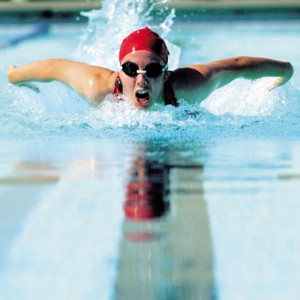

# Anxiety Impedes Peak Performance

How is speaking before a group like being a world-class swimmer?

The performance of both can be impaired by worry and anxiety.

Nine-time Olympic swim champion Dara Torres, 42 years old, was co-captain of the US team competing in the 2009 FINA world championship. She nearly blew her first major international competition in 1984 when she panicked in the preliminaries.

Today she coaches her teammates Katie Hoff and Federica Pellegini on how to alleviate their performance-affecting prerace anxiety. Michael Phelps, widely considered the greatest swimmer of all time, has trained since the age of 12 to master his state of mind so he can perform at his peak in each race.

These athletes have overcome the crippling problem of fear and anxiety and become champions.

### You can too.

You don’t have to do it alone. **Get a coach.** Your **executive speaking coach** will help you master your fear, reduce your anxiety and liberate you to excel.

Anxiety is perhaps the most common concern we hear from clients. Whether they call it stage fright, performance anxiety or nerves, the fear of public speaking impedes (and can even prevent) their performance.

Overcoming anxiety is complex and** there is no “one size fits all” approach** to helping you overcome yours. However, there are **built-in mechanism**s the body has for relieving anxiety which you will find valuable to draw upon to reduce, if not overcome, your case of the nerves.

- Take a deep cleansing breath.
- Stand or sit sill, with your arms comfortably at your side. Close your eyes. Breathe slowly and gently. If standing, bend your knees very slightly. Relax your jaw so your teeth don’t touch. Consciously relax your muscles, especially the shoulders, face and abdomen. Think of a calm and peaceful outdoor place such as the beach, a flower garden or the woods.
- Smile. It’s important that it is a genuine smile so think of something funny or someone that delights you.

While these sound simple they are deceptive. They are actually a powerful counter force to the adrenaline your body produces when you’re anxious or scared. When adrenaline courses through your body, your heart rate speeds up and you mind may race. Your muscles will tense so they are ready to “fight or flight”. These counter measures will reduce the affect and clear your mind so you can focus.

### Don’t let anxiety impede your performance.

Get the help you need to overcome the crippling fear of public speaking so you, too, can become a champion. Work with a coach who can help you personally. A good coach will be able to find the right triggers and methods to suit you. Speaking for impact is not an accident. It's a skill.
