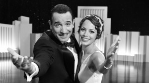

# Are you giving a “Best Picture” performance?

Are you giving a “Best Picture” performance? The Academy Award-winning silent-era-style movie, The Artist, truly underscores that powerful movements and expressions create impact. What did the actors in this movie communicate? Joy, anguish, enthusiasm, worry, fear, despair. Even Uggie, the little dog demonstrated the power of purposeful movement as he hustled down the street to get help to save the life of his owner, George Valentin.

What are *you* “saying” with your body language? How powerful is *your* facial animation?

Take a good hard look at your body language by video recording your next presentation or speech. Watch the recording and notice whether your facial expressions, gestures and movements are purposeful and consistent with your message. Are they improving or diminishing your impact?

When coaching professionals, we help them to leverage body language to elevate their impact. Remember, speaking for impact is not an accident. It’s a skill. Effective use of body language is a core presentation skill and public speaking skill.
