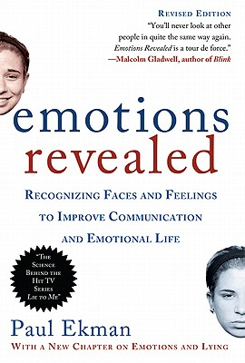
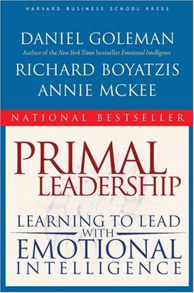

# Books to Expand Your View of Leadership

Reading can expand our minds and change our view of the world. Here is a list of interesting and engrossing books that will challenge your view of leadership.

### [Emotions Revealed](https://www.amazon.com/dp/0805083391)

by Paul Ekman

If a picture is worth a thousand words, what is a facial expression worth? Psychologist Paul Ekman is an expert on facial expressions. For 32 years he was a professor at UC San Francisco. In this fascinating book, Ekman shows the emotional states revealed on the human face. Joy, fear, confusion, compassion – every emotion has a unique facial expression that appears before we can consciously change them. Even when we are *not speaking* facial expressions convey their messages to those around us. Improve your recognition of these expressions and you will be able to read the mind, or more accurately, the heart of others.

### [Leading from Within: Poetry That Sustains the Courage to Lead](https://www.amazon.com/dp/0787988693)

by Sam M. Intrator and Megan Scribner

This collection of poems will give you a fresh perspective on leadership and vision. The book affords you the opportunity to nourish yourself with the power of poetry. In the words of Jeff Swartz, president and CEO, Timberland “*Leading from Within* offers a candid view straight into the heart and soul of leaders striving to do good and effective work in the world. The poems and commentaries remind us that leadership is always deeply personal and chock-full of dilemmas that must be addressed by creativity, passion, imagination, and courage.”

### [Leading Through Conflict](https://www.amazon.com/dp/159139919X)

by Mark Gerzon

As conflict multiplies in business, organizations, and cultures, this book seeks to push the frontier of mediation and leadership to bring resolution.

### [The Talent Code](https://www.amazon.com/dp/055380684X)

by Daniel Coyle

The Talent Code summarizes the common ingredients for optimal learning of any skill. It also gives a compelling neurological explanation of how and why those ingredients are so important. It will change the way you look at how people learn and may even help you learn new skills more effectively.

### [Primal Leadership](https://www.amazon.com/dp/1591391849)

by Daniel Goleman

Daniel Goleman’s research shows great leaders excel not just through skill and smarts, but by connecting with others using Emotional Intelligence competencies such as empathy and self-awareness.

### [100 Ways to Motivate People: How Great Leaders Can Produce Insane Results Without Driving People Crazy](https://www.amazon.com/dp/1564149927)

by Steve Chandler

Short, motivating, real life stories and anecdotes on how to motivate achievement. Like our Speaking Strengths™ communication model, Chandler believes good leaders build on people’s strengths.

### [Presence](https://www.amazon.com/dp/0141039477)

by Patsy Rodenburg

This book offers insights on how to use your positive energy to achieve success. Rodenburg is a British acting coach has helped many people learn to be present on both the theatrical stage and on the stage of life.

### [Quiet: The Power of Introverts in a World that Can’t Stop Talking](https://www.amazon.com/dp/0307352145)

by Susan Cain

In this thought provoking book, Susan Cain challenges our reverence for the extrovert. She makes the case that the power and impact of the introvert is equal to the extrovert even though we assume introverts are less effective. She takes us on a journey of Dale Carnegie’s birthplace and charts the rise of the Extrovert Ideal.

She offers guidance on how to negotiate differences in introvert-extrovert relationships and introduces us to a witty high-octane speaker who recharges in solitude.

For introverts, this book is validating and inspiring. Extroverts will find it enlightening.

