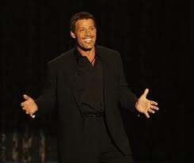

# Do you speak with Command?

**"Command**” is one of the **top ten Speaking Strengths**™ we have identified in our work with executives and leaders. Read about [all ten Speaking Strengths](/insights/speaking-strengths/).

### **Command **- *Powerful presence, in control*

The hallmark of speakers with the “**Command**” strength is the ability to project they are in control. As the listener, you “know” you can rely upon the speaker to be in charge. This strength makes the audience comfortable with the speaker and confident he or she has something meaningful to say.

This strength is complex and developing it will require a multi-faceted approach. But you may begin by working on some of the physical aspects of “Command”. Here are three tips:

- **Posture**: Stand tall and still. Pull your shoulders back and distribute your weight equally on both feet. Hang your hands loosely at your sides. Keep your eyes facing front. This position signals the audience to face you and wait for you to start.
- **Gesture**: From the posture above, add movement and gestures to amplify what you are saying. Good gestures visually reinforce your words.
- **Move**: Purposeful movement creates a sense of audience engagement. Before moving, identify the purpose to avoid aimless shifting or walking around.

Each of these physical actions will make you visually more in command. Remember, speaking for impact is not an accident. It's a skill. Elevate your presentation skills and public speaking skills by identifying your speaking sstrengths and use them to increase your impact.
