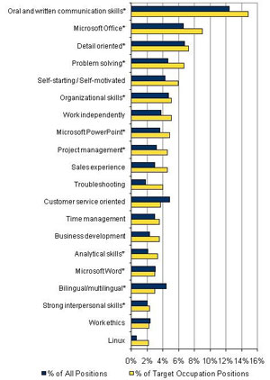

# Do you want to become leadership material?

In our global economy -- as collaboration is required and diversity increases – we know that communication is one of the most important skills in the workplace. If you want to lead and want that next promotion, you need to be a strong, high impact communicator. These three reports are sobering evidence of this fact:

- The [Center for Talent Innovation](http://www.prweb.com/releases/2012/10/prweb10050433.htm ) conducted a year-long study of 4,000 professionals, including more than 200 senior executives. They ranked communication (excellent speaking skills, assertiveness, and the ability to read an audience or a situation) as a critical factor to get ahead. They also agreed that gravitas (projecting confidence) and a polished appearance are part of the executive presence necessary for promotion.
- The [Center for Creative Leadership](http://www.ccl.org/leadership/news/2002/softskillssurvey.aspx?pageId=694) in Greensboro, North Carolina, found that most fired executives were poor communicators. Effective leaders are better at blending trust, empathy and genuine communication with their other skills.
- In a recent [Microsoft survey](http://www.microsoft.com/en-us/news/press/2013/oct13/10-15skillspr.aspx ), communication ranked #1 among the top 20 skills needed for the high-growth, high-wage occupations of the future.

Speaking for impact is not an accident, it's a skill. It’s often hard to gauge your own effectiveness as a communicator. Expert help can make all the difference. Don't go it alone. Get help from seasoned professionals.

Consider attending a program like our [Speaking for Impact®](/speaking-for-impact/) program. Whatever program you choose, make sure it is a hands on - not a class where you sit and listen. You need practice. You need coaching. You need a way to measure yourself. Our program is delivered by seasoned professional coaches who identify your Speaking Strengths™ and provide you powerful 1:1 coaching to leverage those strengths. You will learn to score your strengths (and those of others). In fact, you will practice on-camera - an invaluable way to hone your speaking skills and give yourself a competitive edge.

Good communication includes the right mix of being comfortable, confident and convincing. With the right training, you will be able to inspire and lead your way to that next promotion. Make this your year.

We would love to hear your stories about how you use communication to inspire and lead in your professional life.
