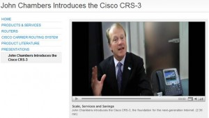
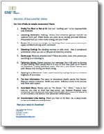

# Executives - Get Ready for Video

More and more executives are inquiring about training for video presentations. Organizations are using YouTube, video interviews, webcasts and website videos to reach a wide audience with key company messages delivered personally by the corporate leaders.

If you’ve done some video you know it’s not as easy as it looks.

### To get you started:

With video, the viewer wants to sense that he or she is in the conversation with you. That intimacy is best suited to a **warm and approachable demeanor and attentive posture**.

**Sit still**. Nodding, fiddling and excessive gestures distract the audience from you! Stay steady and let your **voice** – not your head -- **convey energy**.

**Smile with your eyes** more than your mouth. As when engaged in a one-on-one conversation, smile in response to something that’s said rather than holding a smile on your face the entire segment.

**Do not speak too quickly** or rush to make your points. You’re better off saying less in a calm, animated and interesting way than to try and fit every possible point into your statement.

**Prepare**. Video is **forever** so you don’t want to ramble or misspeak. Prepare your key points in advance and practice them until they are second nature. This will free you up to focus on your delivery rather than formulating what you want to say on-the-fly.

### For more suggestions

**Review** [*Secrets of Successful Video*](/insights/secrets-of-successful-video/) prior to the shoot.

Video is pervasive and powerful and here to stay. Every executive and professional must be ready to leverage this engaging medium. Remember, speaking for impact is not an accident. It's a skill.
