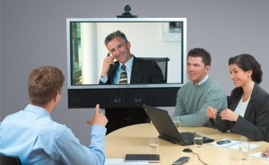

# Lookin’ Good on Video Conference Calls

Video conferencing has become ubiquitous in both the workplace and at home. Services like GoToMeeting, Webex, Vidyo, Facetime and Skype used with a webcam, tablet or Smartphone make it inexpensive and easy to hold virtual meetings with almost all the benefits of an in-person meeting. However, looking good on video requires different considerations than face-to-face meetings.

### Appearance

- Wear clothes that are simple in design and pattern. Busy stripes and prints will appear blurry and distracting on video.
- Use the “self view” window in advance as it will show you how you look to the other participants
- Position the camera directly in front of your face or slightly higher pointing downward. Do not position the camera below your face pointing upward. This is an unflattering and awkward looking position
- Clear the space behind you. A blank wall is ideal. If you have pictures or other objects on the wall behind you, make sure they are hung straight or neatly arranged. Remove loose papers, dishes and other distracting items
- Sit up straight and tall
- Do not eat or drink on the call
- Hold the call in a quiet place. Turn off all distracting sounds from phone, text, email, or perhaps, the barking dog
- Know how to mute yourself and others

### Body language

- Listen with intent
- Keep your eye contact steady with the webcam/camera as that mimics your connection with your audience. Do not look at your own image
- Do use facial expressions
- Do use gestures to make a point. Don’t wave hands wildly or frequently.
- Sit still. Do not swivel in your chair or look away from the person/people on the call. Do not nod your head
- Avoid note taking
- No Multitasking. Ensure no secondary conversations
- Stay focused

### Handling technical difficulties

- If you experience video problems, get out of the video mode and stay on call with the audio. Seamlessly continue. At a break in the conversation, calmly indicate you have lost video
- If you lose audio, calmly tell the other participants you cannot hear who is speaking
- If the call drops, dial back in. When there is a break in the conversation, state that you have rejoined the call. If necessary, ask to be caught up on what you missed
- Avoid coughing or sneezing. If you need to, put the video call on mute/hold

Video conference calls are a great tool for closing the distance gap between you and your team and customers. Used properly, you can create an experience remarkably similar to an in-person conversation. Speaking for impact on video is not an accident - it's a skill.
