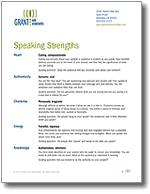

# Be an All-Star: Speak from your Strengths

Every speaker has strengths. In fact, we’ve identified [**ten top Speaking Strengths**™](/insights/speaking-strengths/) in our work with executives and leaders. Read the [full list](/insights/speaking-strengths/).

Of the ten top Speaking Strengths, you almost certainly have one and may have several. By leveraging these strengths you can quickly elevate your speaking skills. We teach you how in our seminar program [Speaking for Impact](/speaking-for-impact/) and in our private coaching sessions but for now, let me say that the **first step** is to know and acknowledge that you have strengths to build on.

I will introduce the Speaking Strength "**Authenticity**" in this post. In future posts I will highlight other strengths.

**[Speaking Strength: ](/insights/speaking-strengths/)Authenticity** - *Genuine, real*

If you have this strength, you convey you are the “real deal”. You are expressing your genuine and sincere self. Your audience never doubts that there is fidelity between your message and your delivery. You are someone your audience feels they can trust.

Tim Lincecum is an example of a public figure who speaks with Authenticity. He is the starting pitcher for the San Francisco Giants. In 2010, he was a World Series Champion and National League All Star. He is widely considered the best pitcher in baseball today. He’s also a very nice guy. He is approachable and genuine. A long-time New York columnist told Lincecum, "*I've never seen anyone better with the media.*"

Here a video of an impromptu, hallway media interview conducted just before the start of the 2011 season. As you watch notice his authenticity. He is thoughtful and candid. Although his eye contact is poor (as is the lighting), pay attention to his speaking style.

Here he is another interview conducted after he won the 2009 Cy Young Award. In this interview he shares personal stories about what motivates, inspires and drives him. Even if you’re not a fan or a player, you will likely feel moved by his remarks.

One of the questions to ask yourself is: do you believe Tim?

Trust is one result of speaking with Authenticity. Authenticity is Tim’s natural speaking strength. His impact is a direct result of allowing his authenticity to shine through in a media interview. He’s the “real deal.”

Can you think of other public figures who speak with Authenticity?

Speaking for impact is not an accident. It's a skill.

### **Share your thoughts**

I hope you enjoyed learning about the Authenticity Speaking Strength. I’ll periodically write about additional Speaking Strengths in future posts.
