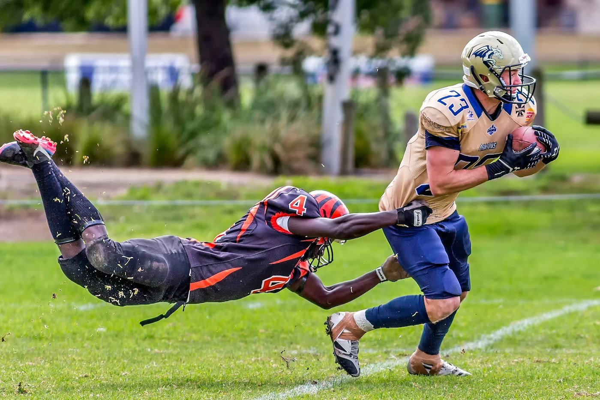
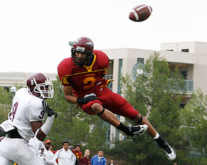

# Speaking Tip: Reception is crucial in football and in speaking!

Reception. It's crucial in football and in speaking.

When the quarterback passes the football, the goal is for the ball to be received. The same is true when you speak. You make your point and the audience needs a moment to receive what you say. This is why the skillful practice of the "pause" is so valuable.

We call it the **"Power of the Pause."**

### Speaking Tip: The Power of the Pause

Deliver a key point and allow your words to **linger** for a few moments. Think of your words sailing - just like a football - through the air. The words need to meet their destination and allow those listeners a moment to "receive" your point. You will actually see the light in the audience's eyes when your pass is received.

Use this tip to build pauses into your remarks and **watch your impact improve**. Remember, speaking for impact is not an accident. It’s a skill. Effective use of the pause is a core presentation skill and public speaking skill.
