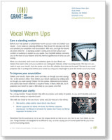

# Speaking Tip: Your mother was right

“Speak up!”, “Don’t mumble!”. Did you hear these words when you were growing up? If so, your mother was right. Poor enunciation and projection render otherwise good communication ineffective. When you speak, you want to be heard – literally. If you speak softly or do not enunciate clearly, your audience may not hear your message.

You may recall the "Moses Supposes" routine from the movie "Signing in the Rain". Gene Kelly and Donald O'Connor meet with a voice coach to practice enunciating by reciting tongue twisters. When you enunciate, each word and syllable is given its due. Words are distinct from each other and you want to make it easy for your audience to distinguish between similar sounding words. The key: ** open your mouth**, **form the words**, and **form the syllables** that make up the word!

To achieve vocal projection allow yourself to breathe fully, into your diaphragm. Your breath gives support for a stronger vocal projection. Breath powers the voice.

Here are two useful exercises you can use right away to improve your enunciation and your vocal projection:

### **To improve clarity:**

- **Practice tongue twisters. **Tongue twisters help with enunciation and clarity of speech, so you don’t stumble over your words when making an important point. ‘She sells sea shells by the sea shore,’ works well, but here are a few others:

- Moses supposes his toeses are roses, but Moses supposes erroneously. For Moses he knowses his toeses aren’t roses, as Moses supposes his toeses to be
- Red leather, yellow leather, black blood, blue blood
- Three tree dwellers
- Cinnamon Synonym
- Betty bought a bit of butter but the bit of butter Betty bought was bitter so Betty bought a bit of better butter to make the bitter butter better

For more tongue twisters, check out this blog post [Tongue Twisters for Actors ](http://acting-blog.com/2011/04/14/tongue-twister-for-actors/)by acting coach Mark Westbrook

### **To improve your vocal projection:**

- **Practice speaking from your diaphragm**. Find the little triangle of soft space between your ribs and place your palm flat on that spot. Then say ‘Hah!’ If your hand does not move, you’re not speaking from your diaphragm and your voice is coming out in a thin ribbon of sound instead of a powerful room-filling projection. Try it again. If you’re speaking from your diaphragm effectively, your hand should actually jump up a little bit from your midsection as you say ‘Hah!’

Speaking for impact is not an accident. It's a skill. Enunciation and vocal projection are core presentation skills and public speaking skills. For these and more exercises, see our handy reference guide, [**Vocal Warm Ups**](/insights/vocal-warm-ups/).

You can keep the card in your briefcase or speech folio where it will be handy before your next presentation.
