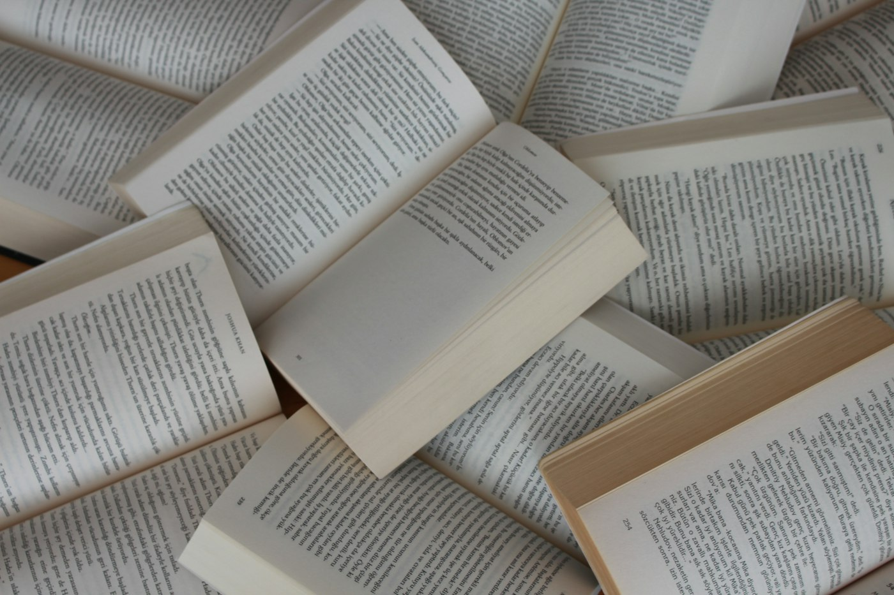
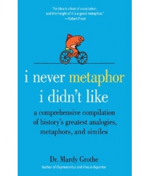
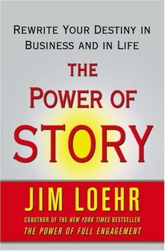
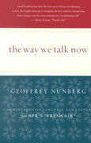
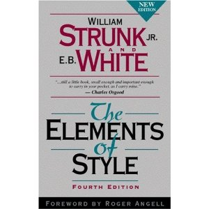
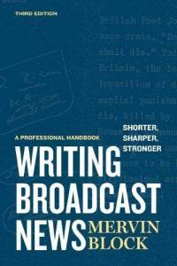
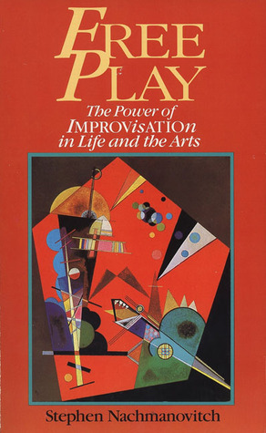

# Top 7 "Good Reads" for Communicators

As you might imagine, I’ve read dozens and dozens of books on communications. Here’s my short-list of “good reads.” None is new. For leaders, executives and other professional communicators, these books will stimulate your thinking, creativity and productivity, even if you read small bits at a time. Whether you are looking to improve your impact, strengthen your vocal instrument, or write well, your time will be well spent with these titles.

### [The Right to Speak](https://www.amazon.com/dp/0878300554)

by Patsy Rodenburg

Vocal control and variety are powerful tools for creating impact when you speak. British acting coach, Patsy Rodenburg, details how to understand your vocal instrument and provides skillful exercises to enhance your vocal communication.

### [I Never Metaphor I Didn’t Like](https://www.amazon.com/dp/0061358134)

by Dr. Mardy Grothe

Known affectionately as the “quotation maven,” Grothe inspires creative thinking and more interesting speaking. He presents a plethora of quotes, each in the context of a story. This book is a good value even if you have time for just parts of it; and it is a wonderful resource for speechwriting.

### [The Power of Story: Change Your Story, Change Your Destiny in Business and in Life](https://www.amazon.com/dp/0743294688)

by Jim Loehr

Storytelling is an essential skill for effective leaders and communicators. However, the stories we tell ourselves about ourselves have a powerful effect on our success. In this insightful book, Loehr calls on you to give your life-energy to telling your own powerful, authentic story.

### [The Way We Talk Now](https://www.amazon.com/dp/B003YCQGHW)

by Geoffrey Nunberg

The changing English language is chronicled here with easy-to-digest commentaries on our current language and culture. Nunberg is an American linguist, a professor at Stanford and a commentator on NPR’s Fresh Air. Witty and erudite, Nunberg shows how our daily language reveals who we are and who we want to be. His [blog, Language Log,](http://languagelog.ldc.upenn.edu/nll/?author=11) offers additional insights.

### [The Elements of Style](https://www.amazon.com/dp/0205313426)

by Strunk and White

This thin volume was first published in 1918 and to this day is a “bible” for the principles of composition and usage. Study it to increase clarity, precision and brevity in your writing and speaking.

### [Writing Broadcast News](https://www.amazon.com/dp/1608714179)

by Mervin Block

Merv is a master of writing in clear, simple language. He wrote for CBS and ABC evening news and makes explicit what good writers do implicitly for impact and ease of understanding. Everyone seeking to improve their writing would do well to learn from this master of storytelling. Merv also offers a number of [articles](http://www.mervinblock.com/?q=node/39) on his website.

### [Free Play](https://www.amazon.com/dp/0874776317)

by Stephen Nachmanovitch

This is a resource to build your improvisation skills. It applies to your life, your art – and your speaking! It offers practical techniques on getting past blocks. It is inspiring and offers useful insights into the nature of the creative act. Here's a list of [suggested readings](http://www.freeplay.com/lists.html) from Stephen on creativity and improvisation.

Spoken communication is a contact sport. So after you’ve enjoyed reading the wisdom offered in this collection of writings, actively apply what you’ve learned to your communications. Remember, speaking for impact is not an accident. It’s a skill.
