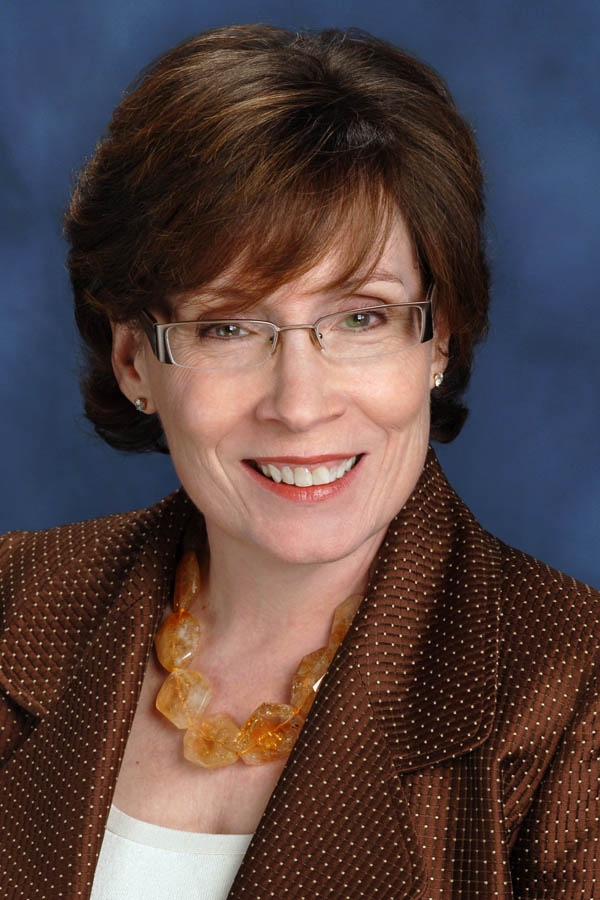

# About Grant and Associates

Grant and Associates provides [media](/coaching-training/media-training/) and [public speaking](/coaching-training/presentation-training/) training for C-level and business executives, public figures, and corporate spokespeople. Our unique [coaching](/coaching-training/) methods focus on identifying and capitalizing upon individual speaking strengths for effective, clear communication. We offer coaching for print, [television](/coaching-training/tv-talent/), radio, video, online media and public speaking, as well as tools for effective communication within the corporate world.

Founded in 1997, Grant and Associates specializes in working with communicators who are ready to up their game. We provide a comprehensive range of services including wardrobe and image consulting, and [speechwriting](/coaching-training/speechwriting/). Our services are delivered by seasoned professionals one-to-one or in small groups.

## About our principal, Judy Grant

Judy Grant brought two decades of experience in front of and behind the camera to the training of business professionals, public figures and on-air talent. Her award-winning career covers all facets of news media, from reporting and television news anchoring to program management and producing.

After her initial work as an anchor and news director at KELO-TV in Sioux Falls, South Dakota, Grant entered the national market at CBS Network News in New York. As Night News Manager, she wrote and produced for some of the biggest names in broadcasting including Dan Rather, Charles Osgood, and Bill Kurtis.

From there, she joined WCAU-TV in Philadelphia as Senior Producer of an award-winning weekly news series. Grant then became News Director of Sacramento's CBS affiliate, winning the California Associated Press Broadcast award for Spot News Coverage while the station reached the highest ratings in its history.

Grant served as Vice President of News and Production for Preview Media, San Francisco, the largest producer of travel programming. Here she produced and managed program productions, including a national series with Christopher Reeve. Grant ran the 24-hour news and information channel, BayTV in San Francisco, before founding Grant and Associates in 1997.

Since turning her talents exclusively to media and presentation training and consultation, Grant has worked with CEOs, senior executives, major city reporters, anchors, sports figures, and New York Times best-selling authors. She pioneered a ground-breaking method focused on identifying and amplifying a speaker's strengths that produces rapid, lasting results. Grant is a popular speaker in her own right and is passionate about helping people to find their voice.

<a class="button" href="/contact/">Contact Judy</a>

